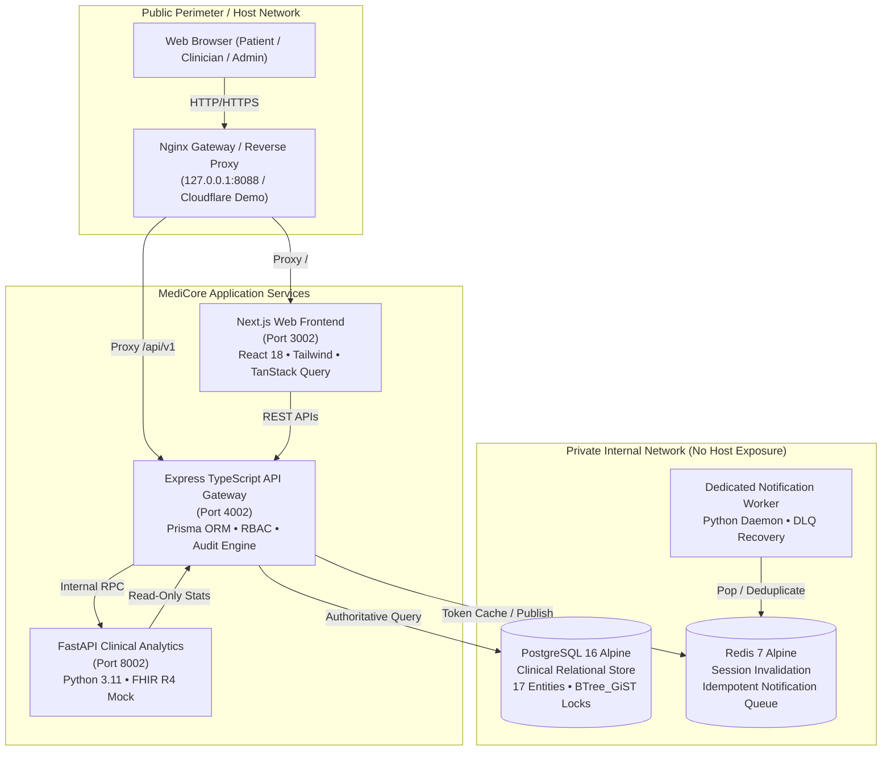
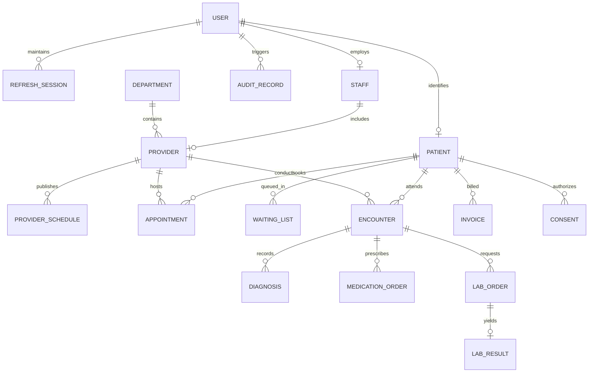

# MediCore — Integrated Hospital Management Platform

[](https://github.com/Naik1437/MediCore/actions/workflows/ci.yml)
[](docker-compose.yml)
[](https://nodejs.org)
[](https://python.org)
[](https://postgresql.org)
[](#)

MediCore is an educational engineering implementation of an integrated hospital operations and clinical information platform. It is engineered for high-integrity synthetic electronic medical records (EMR), multi-role encounter workflows, diagnostic tracking, and healthcare interoperability. Built with a zero-trust architecture, strict least-privilege role boundaries, and consent-aware data filtering, MediCore models secure healthcare operational patterns on synthetic data.

> **Important Educational & Synthetic Data Disclaimer:**  
> MediCore operates strictly on synthetic, non-identifiable test data. It is an educational engineering project designed to satisfy the Orion LMS Advanced Assessment requirements (MC-01 through MC-15). It does not hold medical device certifications (e.g., FDA, CE-mark), nor does it certify legal HIPAA/GDPR compliance. It must never be used for real medical diagnoses, live patient care, or clinical decision-making.

---

## Architecture Diagram (MC-14)



---

## Relational Entity-Relationship Diagram (MC-03)



---

## Technology Stack & Actual Dependency Versions

Versions extracted directly from workspace manifest files (`package.json`, `frontend/package.json`, `backend/package.json`, `analytics/requirements.txt`):

| Domain | Technology / Package | Version | Purpose |
|:---|:---|:---|:---|
| **Frontend Portal** | Next.js (App Router) | `16.4.6` | SSR & client application portal |
| | React / React DOM | `^18.3.1` | Component lifecycle & rendering engine |
| | TanStack Query | `^5.51.1` | Asynchronous server-state management |
| | Tailwind CSS | `^3.4.7` | Design system and utility styling |
| | Tailwind Merge & clsx | `^2.4.0` / `^2.1.1` | Conditional utility class merging |
| | Lucide React | `^0.417.0` | Accessible SVG iconography |
| | Playwright | `^1.48.0` | End-to-end browser regression automation |
| | Vitest / Vite | `5.1.1` / `7.3.8` | Monorepo test runner & build engine |
| **Backend API Gateway** | Node.js | `v22.x` | Runtime execution platform |
| | Express | `^4.19.2` | REST API routing and middleware pipeline |
| | TypeScript | `^5.4.5` | Strict static typing across domain models |
| | Prisma ORM & Client | `^5.19.0` | Schema migrations & transactional database access |
| | Zod | `4.6.7` | Runtime schema validation on API payloads |
| | bcryptjs | `^2.4.3` | Password hashing & verification (cost 10) |
| | jsonwebtoken | `^9.0.2` | JWT access & refresh token lifecycle |
| | Helmet | `^7.1.0` | HTTP security headers |
| | CORS | `^2.8.5` | Origin access control & trusted origin filtering |
| | Swagger UI Express | `^5.0.1` | Interactive OpenAPI documentation UI |
| | Supertest | `^7.0.0` | Integration HTTP test framework |
| **Analytics Engine** | Python | `3.11` | Clinical data processing & statistics |
| | FastAPI | `>=0.115.0` | Asynchronous analytics microservice |
| | Pydantic | `>=2.9.0` | Data models and FHIR R4 resource validation |
| | Uvicorn | `>=0.32.0` | ASGI production application server |
| | HTTPX | `>=0.27.0` | Asynchronous HTTP client for internal service RPC |
| | Redis Python | `>=5.0.0` | Redis client for background job queueing |
| | Pytest & pytest-asyncio | `>=8.0.0` / `>=0.24.0` | Analytics unit test & benchmark runner |
| **Data & Infrastructure** | PostgreSQL | `16-alpine` | Primary ACID relational database (17 entities) |
| | Redis | `7-alpine` | Distributed cache, token blacklist & DLQ |
| | Nginx | `alpine` | Lightweight same-origin gateway on port 8088 |
| | Docker & Docker Compose | `v2.24+` | Multi-container isolated microservice network |

---

## Seven Granular User Roles

MediCore implements strict role-based access control (RBAC) with server-side authorization enforcement:

1. **`PATIENT`**: Self-service profile management, appointment scheduling, personal health records access, and granular consent granting/revocation.
2. **`RECEPTIONIST`**: Patient registration, appointment intake, check-in progression, and provider schedule management.
3. **`DOCTOR`**: Consultation management, clinical notes, ICD-10 diagnosis recording, medication orders, and lab requisitions.
4. **`NURSE`**: Patient triage, vital signs observation, encounter status advancement, and clinical support workflows.
5. **`LAB_TECHNICIAN`**: Diagnostic lab order fulfillment, specimen status updates, and lab result entry with patient-verification validation.
6. **`BILLING_OFFICER`**: Invoice creation, payment reconciliation, fee calculation, and claims processing.
7. **`HOSPITAL_ADMIN`**: Operational oversight, audit log review, department/staff provisioning. **Strictly isolated from viewing patient clinical records (PHI)**.

---

## Multi-Container Runtime (Seven Orchestrated Services)

All seven containers run concurrently on the host in an isolated Docker bridge network:

| # | Container Name | Image | Network Exposure | Role & Responsibility |
|:---:|:---|:---|:---|:---|
| 1 | `medicore-gateway` | `nginx:alpine` | `127.0.0.1:8088` (Loopback only) | Unified reverse proxy routing frontend (`/`) and API (`/api/v1`) through the same origin |
| 2 | `medicore-frontend` | `medicore-frontend:latest` | `3002:3002` (Host) | Next.js 16 App Router role-based clinical interface |
| 3 | `medicore-backend` | `medicore-backend:latest` | `4002:4002` (Host) | Express 4 TypeScript business API, authentication, and audit engine |
| 4 | `medicore-analytics` | `medicore-analytics:latest` | `8002:8002` (Host) | FastAPI Python 3.11 clinical analytics and FHIR R4 mock adapter |
| 5 | `medicore-notification-worker` | `medicore-analytics:latest` | Internal only | Background Redis daemon processing retry-safe notifications and DLQ recovery |
| 6 | `medicore-postgres` | `postgres:16-alpine` | Internal only (`medicore-internal`) | Relational store housing all 17 clinical and administrative entities |
| 7 | `medicore-redis` | `redis:7-alpine` | Internal only (`medicore-internal`) | Ephemeral session cache, refresh token revocation blacklist, and notification queue |

---

## Verified Cloudflare HTTPS Tunnel Demonstration

To validate live remote HTTPS accessibility without exposing private infrastructure or opening firewall ports, a temporary Cloudflare Tunnel demonstration was successfully verified:

- **Loopback Ingress**: The `medicore-gateway` reverse proxy was bound strictly to `127.0.0.1:8088`, preventing direct LAN or WAN access.
- **Same-Origin Unified Routing**: Both the Next.js frontend (`/`) and the Express REST API (`/api/v1`) were routed through the same public origin via the tunnel, eliminating mixed-content warnings and third-party cookie restrictions.
- **Strict Private Isolation**: PostgreSQL, Redis, and Analytics endpoints were completely excluded from gateway routing and remained private on the internal Docker network.
- **Restricted CORS Policy**: Wildcard domain matching was replaced with an explicit trusted-origin registry (`backend/src/config/env.ts`), permitting only trusted local addresses and the explicitly configured tunnel hostname.
- **Credential & URL Protection**: In compliance with security standards, ephemeral tunnel URLs and active credentials are not committed to source control or logged.

---

## Account Hardening & Session Revocation

To prevent unauthorized public access during live demonstrations, all pre-seeded development credentials were hardened:

- **Seven Rotated Seeded Accounts**: All 7 default seeded accounts (`patient@medicore.local`, `receptionist@medicore.local`, `doctor@medicore.local`, `nurse@medicore.local`, `labtech@medicore.local`, `billing@medicore.local`, `admin@medicore.local`) were secured with unique, cryptographically strong passwords (>= 32 characters) hashed using `bcrypt` (cost 10).
- **Default Password Invalidation**: The backend was verified to reject the former default development password (`Password123!`) with `HTTP 401 Unauthorized` across all accounts (`scripts/verify_default_credentials_rejected.js`).
- **20 Revoked Refresh Sessions**: An atomic SQL update invalidated all 20 historical active refresh sessions in the PostgreSQL `RefreshSession` table (`revokedAt = NOW()`) to terminate pre-existing sessions.
- **Data Preservation**: Zero patient records, encounters, diagnoses, lab orders, or invoices were modified or removed.
- **Confidentiality**: New credentials were written exclusively to the git-ignored `.env.seeded_accounts` file in the project root and are never exposed in logs or documentation.

---

## Automated Verification: Mocks vs. Real Integration Evidence

MediCore's test suite strictly distinguishes fast isolated unit tests from end-to-end integration proof:

| Test Scope | Suite / Runner | Count | Real vs. Mock Classification | Verified Coverage |
|:---|:---|:---:|:---|:---|
| **Backend Unit & Authorization** | Vitest (`backend/tests/`) | 45 | **Mocked Services** | Controllers, service logic, and token hashing tested using Vitest in-memory mocks (`vi.fn()`) |
| **PostgreSQL Schema & Security Integration** | Vitest + Supertest (`integration_postgres.test.ts`) | 5 | **Real Integration** | Real database constraints, IDOR cross-patient isolation, Admin PHI separation, and FHIR schema validation |
| **Frontend Component & Role UI** | Vitest (`frontend/tests/`) | 14 | **Mocked Client** | React Testing Library checking alerts, badges, and dashboard components using mocked `apiFetch` |
| **Clinical E2E Journeys** | Playwright (`frontend/tests/e2e/`) | 3 | **Real Integration** | Browser automation executing full journeys against running Next.js, Express, and PostgreSQL services |
| **Python Analytics & Interoperability** | Pytest (`analytics/tests/`) | 15 | **Real Integration** | FastAPI endpoints, live worker retries, DLQ queue inspection, and FHIR resource generation |
| **Clinical Data Processing Benchmark** | Python Benchmark Script | 1 | **Real Processing** | Validated **206,481 records/sec** throughput on 5,000 synthetic lab records (`analytics/benchmark_report.json`) |
| **Operational Incident Scenarios** | Python Incident Runner | 5 | **Real Integration** | 5 operational failure scenarios executed against live services with error evidence captured |

---

## Operational Incident Simulation (MC-15)

MediCore includes an automated incident injection framework (`scripts/simulate_incidents.py`) with evidence captured in `docs/incident_simulation_evidence.json`. All 5 mandatory failure scenarios were verified across separate host runs:

1. **Unauthorized Record Access**: Rejects unauthenticated PHI queries with HTTP 401 Unauthorized (`Bearer authentication token is required`) with genuine audit request IDs (`253bc7f7-e320-422d-9695-21c633c2f213`).
2. **Appointment Scheduling Conflict**: Initial booking returns HTTP 201; immediate concurrent booking for the same provider time slot is blocked with HTTP 409 Conflict via database transactional locks and PostgreSQL exclusion constraints (`appointment_no_overlap`).
3. **Notification Sandbox Dead-Letter Queue (DLQ)**: Invalid notification delivery attempts trigger retry exhaustion after 2 attempts, pushing the failed job (`f5558b08-3628-4413-879f-0ad87a94528f`) to the Redis DLQ (`medicore:notifications:dlq`) with audit state preserved.
4. **Database Outage Resilience**: API gateways gracefully handle database service interruptions, returning standardized HTTP 503 Service Unavailable (`67ada043-3ba2-4d1c-b057-8f5d0d3ab08c`) without crashing or exposing raw stack traces.
5. **Lab Patient Mismatch Protection**: Submitting diagnostic lab results with mismatched patient IDs is rejected with HTTP 400 Bad Request, preserving diagnostic association integrity.

---

## 15 Assessment Matrix & Requirement Traceability

| Assessment ID | Description | Technology Stack | Status |
| :--- | :--- | :--- | :--- |
| **MC-01** | Healthcare role-based frontend | Next.js 16 App Router, React 18, Tailwind, TanStack Query | **Completed** |
| **MC-02** | Hospital Backend APIs | Node.js 22, Express, TypeScript, Zod | **Completed** |
| **MC-03** | Clinical Relational Database | PostgreSQL 16, Prisma ORM (17 Entities) | **Completed** |
| **MC-04** | Clinical Data Security & RBAC | 7 Granular Roles, Default-Deny, Admin PHI Isolation | **Completed** |
| **MC-05** | Python clinical data processing | Python 3.11, Range Validators, 206k rec/sec Benchmark | **Completed** |
| **MC-06** | FastAPI clinical analytics | FastAPI, Non-Diagnostic Metrics, SLA Compliance | **Completed** |
| **MC-07** | Appointment & care workflow engine | Concurrency locks, Overlap exclusion, FSM state engine | **Completed** |
| **MC-08** | Healthcare interoperability | HL7 FHIR R4 Mock (Patient/Obs), Idempotent Worker, DLQ | **Completed** |
| **MC-09** | Containerized Docker foundation | Docker Compose (7 Services), Non-root, Healthchecks | **Completed** |
| **MC-10** | Local Git & change review | CODEOWNERS, PR templates, Clinical checklists | **Completed** *(Remote PR peer review approvals pending)* |
| **MC-11** | CI/CD automated pipeline | GitHub Actions (Build, Test, Scan, Release) | **Completed** *(Automated workflow verified; cloud trigger pending push)* |
| **MC-12** | Privacy & workflow testing | Supertest integration tests & Playwright E2E specs | **Completed** |
| **MC-13** | Complete API documentation | OpenAPI 3.0 / Swagger UI (`/docs`), Postman Collection | **Completed** |
| **MC-14** | Secure hospital deployment | Production Compose, Nginx proxy, Backup scripts | **Completed** *(Permanent cloud VM hosting & commercial CA cert pending)* |
| **MC-15** | Incident simulation & recovery | Reproducible incident scripts, 5 verified host scenarios | **Completed** |

---

## Quick-Start & Docker Compose Deployment

### Prerequisites
- [Docker](https://docs.docker.com/get-docker/) 24.0+ and Docker Compose v2.24+
- [Node.js](https://nodejs.org/) v22.x and npm v10+
- [Python](https://www.python.org/) 3.11+
- PowerShell 7+ (Windows) or Bash (Linux/macOS)

### Safe Environment Configuration
MediCore enforces a production fail-fast check that prevents startup with default secrets. Ensure your local `.env` is configured before launch:

```bash
# 1. Copy the safe configuration template
cp .env.example .env

# 2. Populate cryptographically strong secrets in .env
# Required keys: POSTGRES_PASSWORD, JWT_SECRET, JWT_REFRESH_SECRET, ANALYTICS_SHARED_SECRET
```
> **Security Note:** The `.env` and `.env.seeded_accounts` files are excluded from version control via `.gitignore`. Never commit secrets to source control.

### Launch Containers

```bash
# Start all 7 orchestrated containers in detached mode
docker compose up -d

# Verify all containers are healthy
docker compose ps
```

### Application Endpoints & Documentation

| Service | Port | Local URL | Description |
|:---|:---:|:---|:---|
| **Loopback Gateway** | `8088` | [http://127.0.0.1:8088](http://127.0.0.1:8088) | Unified Nginx same-origin reverse proxy |
| **Web Frontend** | `3002` | [http://localhost:3002](http://localhost:3002) | Next.js role-based dashboard portal |
| **Backend API Gateway** | `4002` | [http://localhost:4002/api/v1](http://localhost:4002/api/v1) | Express REST API base endpoint |
| **API Documentation** | `4002` | [http://localhost:4002/docs](http://localhost:4002/docs) | Interactive Swagger UI / OpenAPI 3.0 spec |
| **FHIR R4 Metadata** | `4002` | [http://localhost:4002/api/v1/fhir/r4/metadata](http://localhost:4002/api/v1/fhir/r4/metadata) | HL7 FHIR CapabilityStatement |
| **Analytics Engine** | `8002` | [http://localhost:8002/docs](http://localhost:8002/docs) | FastAPI documentation & statistics |
| **Notification DLQ** | `8002` | [http://localhost:8002/api/v1/notifications/dlq](http://localhost:8002/api/v1/notifications/dlq) | Dead-Letter Queue audit inspector |

---

## Running Test Suites Locally

```bash
# 1. Run Backend Vitest Suite (Unit & Postgres Integration)
npm --prefix backend test

# 2. Run Frontend Component Suite & Next.js Production Build
npm --prefix frontend test
npm --prefix frontend run build

# 3. Run Playwright E2E Suite (Requires running services)
npm --prefix frontend run test:e2e

# 4. Run Python Analytics Pytest Suite
python -m pytest analytics/tests -v

# 5. Run Consolidated Platform Verification Script
powershell -ExecutionPolicy Bypass -File .\scripts\verify_all.ps1

# 6. Verify Default Credentials Rejection
node scripts/verify_default_credentials_rejected.js
```

---

## GitHub Actions CI Pipeline (MC-11)

The automated continuous integration pipeline (`.github/workflows/ci.yml`) is configured for push and pull request events across `main` and `develop`, defining 4 independent validation jobs:

1. **`static-analysis-and-audit`**: Installs root dependencies (`npm ci`), generates Prisma client types, enforces clean dependency audits (`npm audit --audit-level=critical`), verifies static Next.js/Express builds, and executes regex secret scanning using self-excluding header matching.
2. **`backend-verification`**: Boots isolated PostgreSQL 16 and Redis 7 service containers, executes Prisma migrations, compiles TypeScript, and runs the backend security suite.
3. **`frontend-verification`**: Executes React component tests and compiles the production Next.js bundle.
4. **`analytics-verification`**: Installs Python dependencies and runs the 15-test Pytest analytics and interoperability suite.

---

## Repository Structure

```
MediCore/
├── .github/
│   ├── workflows/           # CI/CD pipelines (ci.yml, release.yml)
│   ├── CODEOWNERS           # Clinical & infrastructure code review policies
│   ├── PULL_REQUEST_TEMPLATE.md
│   └── ISSUE_TEMPLATE/      # Clinical bug & enhancement templates
├── analytics/               # Python 3.11 FastAPI Clinical Analytics microservice
│   ├── samples/             # Sample clinical lab and appointment JSON fixtures
│   ├── tests/               # Pytest analytics and interoperability test suite
│   ├── main.py              # FastAPI application endpoints
│   ├── processor.py         # Clinical data validation & benchmarking engine
│   └── worker.py            # Idempotent notification worker & DLQ manager
├── backend/                 # Node.js + Express + TypeScript API Gateway
│   ├── prisma/              # PostgreSQL schema (17 entities), migrations & seeds
│   ├── src/
│   │   ├── controllers/     # REST and FHIR R4 resource controllers
│   │   ├── middlewares/     # Authentication, RBAC, clinical consent enforcement
│   │   ├── routes/v1/       # Versioned API route definitions
│   │   └── services/        # Business logic, audit logging, workflow transitions
│   └── tests/               # Vitest backend integration & security tests
├── docker/                  # Reverse proxy configurations (nginx.conf, nginx-gateway.conf)
├── docs/                    # Technical architecture, benchmarks, checklists & Postman
│   ├── ARCHITECTURE.md      # System diagrams, ER models & traceability matrix
│   ├── INCIDENT_CONTACTS.md # Escalation hierarchy and SLA matrix
│   ├── PYTHON_PROCESSING_BENCHMARK.md # 206k rec/sec processing benchmark
│   └── medicore_postman_collection.json # Complete API request collection
├── frontend/                # Next.js 16 App Router Web Portal
│   ├── src/
│   │   ├── app/             # Application routes & layouts
│   │   ├── components/dashboards/ # 7 role-specific dashboard views
│   │   └── lib/             # API client, auth context, query provider
│   └── tests/               # Vitest component tests & Playwright E2E specs
├── scripts/                 # Operational automation, backup, restore & verification
│   ├── backup_db.ps1 / .sh  # Automated PostgreSQL backup scripts
│   ├── restore_db.ps1 / .sh # Integrity-validated restore scripts
│   ├── secure_seeded_accounts.js # Account credential rotation & session revoker
│   ├── simulate_incidents.py # Automated failure simulation engine
│   ├── verify_all.ps1       # Consolidated 7-container platform health checker
│   └── verify_default_credentials_rejected.js # Default password rejection tester
├── docker-compose.yml       # Primary container orchestration specification (7 services)
└── package.json             # Monorepo workspaces definition
```

---

## Documented Sandbox & Pending Deployment Scope

- **Notification Sandbox**: Notifications (SMS/Email) are processed through an internal Redis-backed sandbox queue and logged to the Dead-Letter Queue (DLQ) without calling external paid commercial gateways (Twilio/SendGrid).
- **Pending Permanent Cloud Infrastructure**: Local multi-container Docker orchestration, Nginx reverse proxy configurations, and automated database backup/restore scripts are fully implemented and verified. Provisioning of a permanent cloud VM, DNS registrar domain records, and commercial CA-signed TLS certificates remains pending host infrastructure assignment.
- **Pending Peer Review Approvals**: Local Git governance assets (CODEOWNERS, PR templates, migration checklists) are in place; live pull request approvals on remote GitHub remain pending repository push.
- **Synthetic Data Reminder**: All data utilized across appointments, encounters, diagnoses, and lab results is purely synthetic and intended strictly for educational evaluation.
