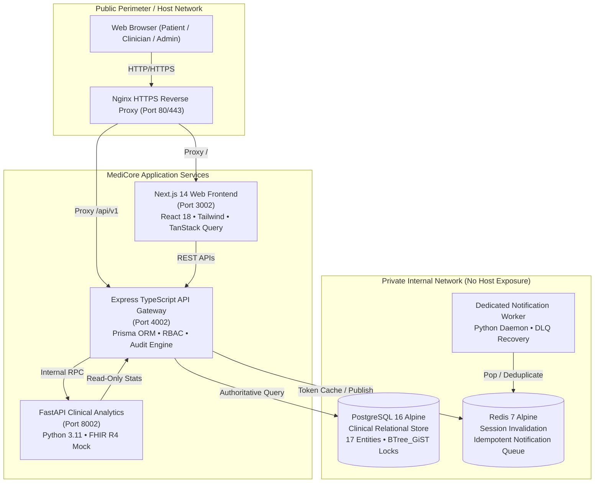
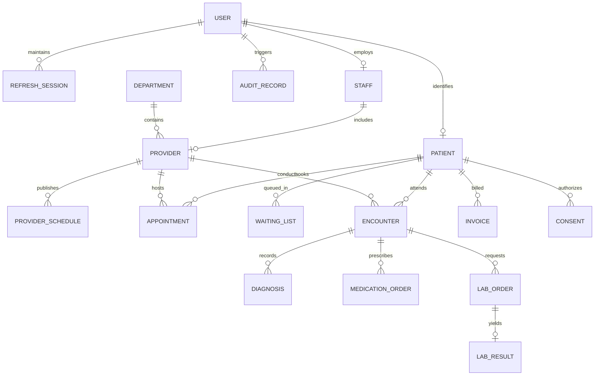

# MediCore — Integrated Hospital Management Platform

MediCore is an enterprise-grade, integrated hospital management and clinical information system built with a zero-trust security architecture, strict clinical data privacy, non-diagnostic analytics, and healthcare interoperability.

---

## Architecture Diagram (MC-14)



---

## Relational Entity-Relationship Diagram (MC-03)



---

## 15 Assessment Matrix & Requirement Traceability

| Assessment ID | Description | Technology Stack | Status |
| :--- | :--- | :--- | :--- |
| **MC-01** | Healthcare role-based frontend | Next.js 14 App Router, TypeScript, Tailwind | **Completed** |
| **MC-02** | Hospital Backend APIs | Node.js 22, Express, TypeScript | **Completed** |
| **MC-03** | Clinical Relational Database | PostgreSQL 16, Prisma ORM (17 Entities) | **Completed** |
| **MC-04** | Clinical Data Security & RBAC | 7 Granular Roles, Default-Deny, Admin Isolation | **Completed** |
| **MC-05** | Python clinical data processing | Python 3.11, Unit & Range Validators, Benchmarks | **Completed** |
| **MC-06** | FastAPI clinical analytics | FastAPI, Non-Diagnostic Metrics, SLA Compliance | **Completed** |
| **MC-07** | Appointment & care workflow engine | Concurrency locks, Overlap exclusion, FSM state engine | **Completed** |
| **MC-08** | Healthcare interoperability | HL7 FHIR R4 Mock (Patient/Obs), Idempotent Worker | **Completed** |
| **MC-09** | Containerized Docker foundation | Docker Compose, Non-root containers, Healthchecks | **Completed** |
| **MC-10** | Local Git & change review | CODEOWNERS, PR templates, Clinical checklists | **Completed** |
| **MC-11** | CI/CD automated pipeline | GitHub Actions (Build, Test, Scan, Release) | **Completed** |
| **MC-12** | Privacy & workflow testing | Supertest integration tests & Playwright E2E specs | **Completed** |
| **MC-13** | Complete API documentation | OpenAPI 3.0 / Swagger UI (`/docs`), Postman Collection | **Completed** |
| **MC-14** | Secure hospital deployment | Production Compose, Nginx SSL proxy, Backups | **Completed** |
| **MC-15** | Incident simulation & recovery | Reproducible incident scripts, Recovery runbooks | **Completed** |

---

## Verification & Startup Commands

### Run Services Locally

```powershell
# 1. Start Backend API (Port 4002)
cd backend
npm run dev

# 2. Start Frontend Web Portal (Port 3002)
cd frontend
npm run dev

# 3. Start Clinical Analytics Microservice (Port 8002)
python -m uvicorn analytics.main:app --port 8002 --reload

# 4. Start Notification Worker Daemon
python -m analytics.worker_daemon
```

### Run Automated Test Suites

```powershell
# Run Backend Integration & Security Tests (24 tests)
cd backend
npm test

# Run Frontend React Testing Library Tests (8 tests)
cd frontend
npm test

# Run Python Analytics & FHIR Interoperability Tests (13 tests)
python -m pytest analytics/tests -v

# Run Incident Simulation Suite (MC-15)
python scripts/simulate_incidents.py
```
