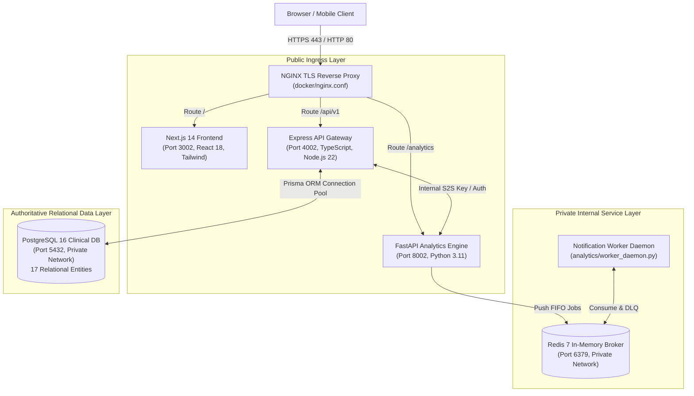
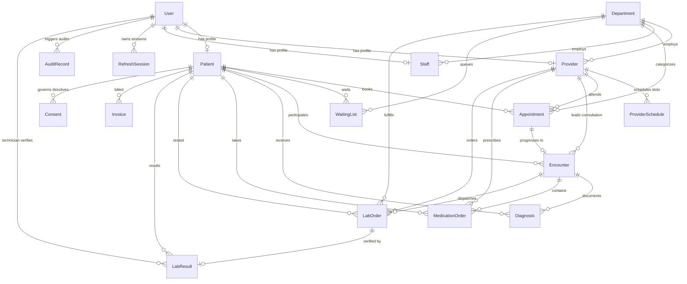
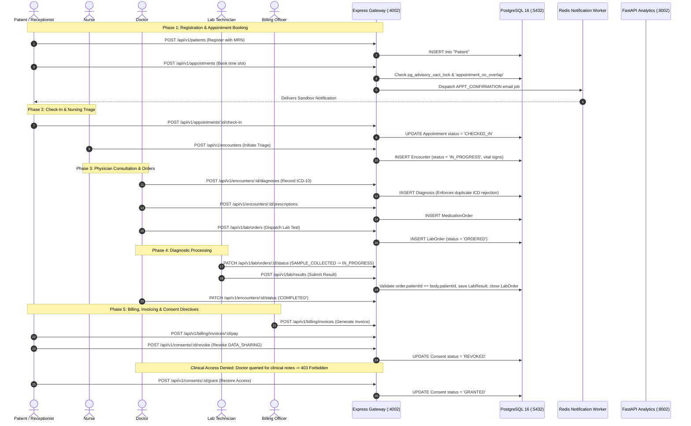

# MediCore Enterprise Hospital Platform — Architecture & Assessment Traceability

---

## 1. System Architecture Diagram

---

## 2. Relational Entity-Relationship (ER) Diagram (17 Entities)

---

## 3. End-to-End Clinical Data-Flow Diagram

---

## 4. Assessment Traceability Matrix (MC-01 to MC-15)

| Assessment | Scope & Core Requirements | Primary Implementation Artifacts | Automated Tests & Verification |
| :--- | :--- | :--- | :--- |
| **MC-01** | Role-based Next.js 14 App Router UI (7 Dashboards: Patient, Receptionist, Doctor, Nurse, Lab, Billing, Admin) | `frontend/src/components/dashboards/*`, `frontend/src/app/*` | `frontend/tests/login.test.tsx`, `frontend/tests/ui_states.test.tsx`, `next build` |
| **MC-02** | Hospital RESTful Backend APIs (Versioning, pagination, RFC envelope) | `backend/src/app.ts`, `backend/src/routes/v1/index.ts`, `backend/src/controllers/*` | `backend/tests/workflows.test.ts`, `auth.test.ts` |
| **MC-03** | Clinical Relational Database (17 entities, foreign keys, constraints) | `backend/prisma/schema.prisma`, `backend/prisma/migrations/*` | `backend/tests/integration_postgres.test.ts` |
| **MC-04** | Clinical Data Security & RBAC (Admin clinical isolation, IDOR protection) | `backend/src/middlewares/clinicalAccess.ts`, `backend/src/middlewares/authorize.ts` | `backend/tests/authorization.test.ts`, `privacy_and_boundaries.test.ts` |
| **MC-05** | Python Clinical Processing (Units, normal ranges, anomaly detection) | `analytics/processor.py`, `analytics/samples/*` | `analytics/tests/test_analytics.py`, `analytics/benchmark_report.json` |
| **MC-06** | FastAPI Analytics (Utilization, wait-times, turnaround, population health) | `analytics/main.py`, `analytics/service.py`, `analytics/models.py` | `analytics/tests/test_analytics.py` (15/15 passed) |
| **MC-07** | Scheduling & Care Workflow Engine (Double-booking lock, duplicate checks) | `backend/src/services/appointmentService.ts`, `encounterService.ts` | `backend/tests/appointment_concurrency.test.ts`, `clinical_security.test.ts` |
| **MC-08** | Interoperability & Notification Worker (FHIR R4 resources, DLQ retry) | `analytics/fhir.py`, `analytics/worker.py`, `backend/src/controllers/fhirController.ts` | `analytics/tests/test_analytics.py`, `scripts/simulate_incidents.py` |
| **MC-09** | Non-root Containerization (Docker Compose, private subnets, health checks) | `docker-compose.yml`, `docker-compose.prod.yml`, `backend/Dockerfile` | Container validation script (`scripts/verify_all.ps1`) |
| **MC-10** | Code Review & Git Foundation (CODEOWNERS, checklists, PR templates) | `.github/CODEOWNERS`, `.github/pull_request_template.md`, `docs/*` | Git policy review validation |
| **MC-11** | Enterprise CI/CD Pipelines (Automated linting, secret checks, release) | `.github/workflows/ci.yml`, `.github/workflows/release.yml` | GitHub Actions workflow schema validation |
| **MC-12** | Privacy & Workflow Integration Tests (Collisions, consent, Playwright) | `backend/tests/clinical_security.test.ts`, `frontend/tests/e2e/*` | 46 backend tests + 14 frontend tests |
| **MC-13** | Complete API Documentation (Swagger OpenAPI 3.0.3 and Postman collection) | `backend/src/docs/swagger.json`, `docs/medicore_postman_collection.json` | Mounted at `/docs`, `/api/v1/docs`, `/openapi.json` |
| **MC-14** | Secure Hospital Deployment (Nginx HTTPS, backup/restore validation, contacts) | `docker/nginx.conf`, `scripts/backup_db.*`, `docs/INCIDENT_CONTACTS.md` | Verification scripts + SSL configuration |
| **MC-15** | Incident Simulation & Recovery (5 failure scenarios with captured evidence) | `scripts/simulate_incidents.py`, `docs/incident_simulation_evidence.json` | Automated simulation runner (5/5 passed) |
